<p align="center">
  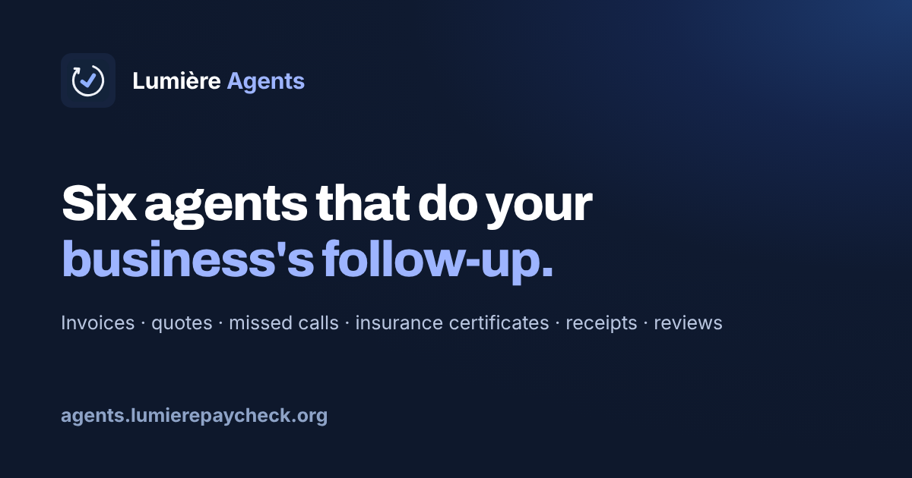
</p>

# Lumière Agents

**Done-for-you follow-up for small businesses.** Six agents that chase unpaid invoices, follow up on quotes, text back missed callers, collect insurance certificates, round up receipts and ask for reviews, in your name and from your own email or business number. You approve every email until you're ready to let it run.

🌐 **Live:** https://agents.lumierepaycheck.org  ·  📖 [Guides](https://agents.lumierepaycheck.org/docs)  ·  🔐 [Security](https://agents.lumierepaycheck.org/security)  ·  📈 [Status](https://agents.lumierepaycheck.org/status)  ·  💵 [Pricing](https://agents.lumierepaycheck.org/#pricing)

> This repository is the public home for Lumière Agents: docs, the API and webhook reference, code examples, screenshots and feedback. The service itself is hosted and closed-source. The examples and docs here are MIT licensed.

<p align="center">
  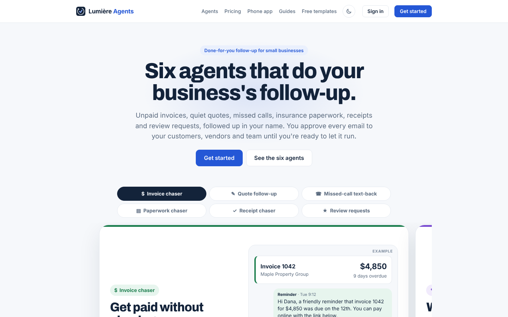
</p>

---

## The six agents

Each one has a one-minute walkthrough (captions, no sound). Click a picture to watch.

| | Agent | What it does |
|---|---|---|
| <a href="https://agents.lumierepaycheck.org/walkthrough/invoice-chaser">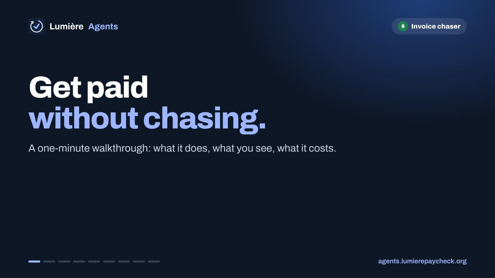</a> | **[Invoice chaser](https://agents.lumierepaycheck.org/invoice-chaser)** | Polite reminders on overdue invoices from your own email address, on day 1, 7 and 14 after the due date. Understands replies like "we'll pay Friday", hands disputes to you, and stops the moment it's paid. For business customers. |
| <a href="https://agents.lumierepaycheck.org/walkthrough/quote-follow-up"></a> | **[Quote follow-up](https://agents.lumierepaycheck.org/quote-follow-up)** | A friendly check-in 2, 5 and 12 days after every quote or estimate, in your name, until the customer replies. |
| <a href="https://agents.lumierepaycheck.org/walkthrough/missed-call-text-back">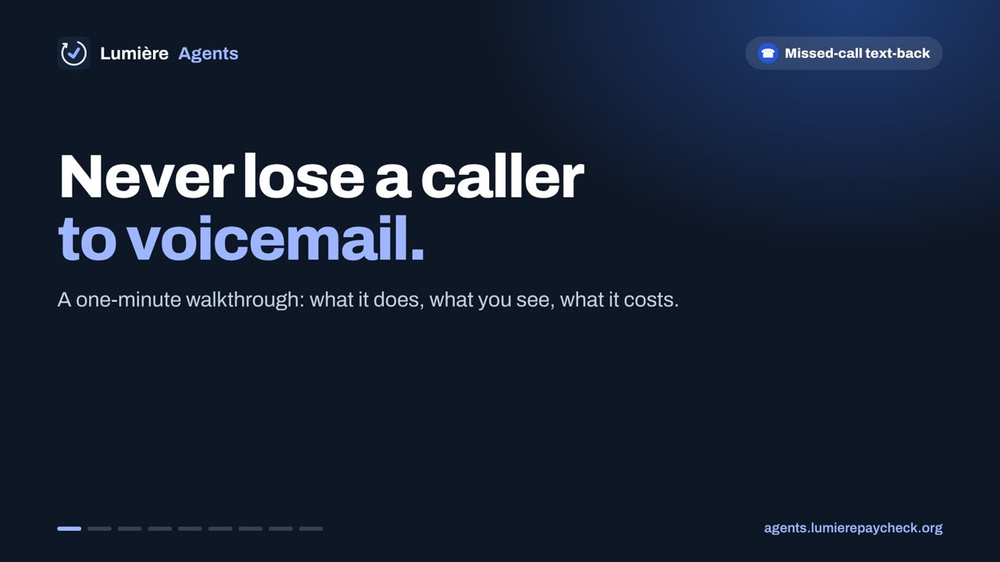</a> | **[Missed-call text-back](https://agents.lumierepaycheck.org/missed-call-text-back)** | Every caller you miss gets a text within a minute from your business number, asking what they need. Anything urgent goes straight to you. |
| <a href="https://agents.lumierepaycheck.org/walkthrough/paperwork-chaser">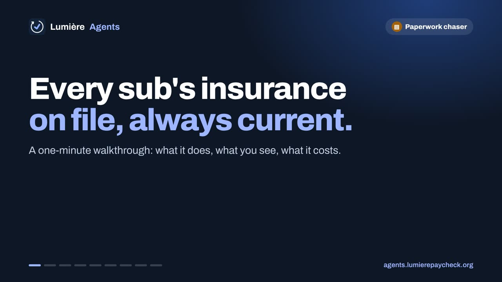</a> | **[Paperwork chaser](https://agents.lumierepaycheck.org/paperwork-chaser)** | Collects certificates of insurance from your subs and vendors, checks them against your checklist, and asks for renewals before they lapse. |
| <a href="https://agents.lumierepaycheck.org/walkthrough/receipt-chaser">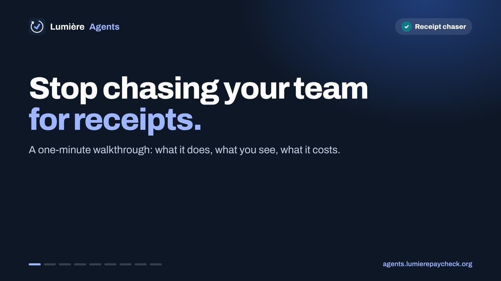</a> | **[Receipt chaser](https://agents.lumierepaycheck.org/receipt-chaser)** | Every Monday, whoever holds the company card is asked for the missing receipts. Your bookkeeper gets a summary each month. |
| <a href="https://agents.lumierepaycheck.org/walkthrough/review-requests">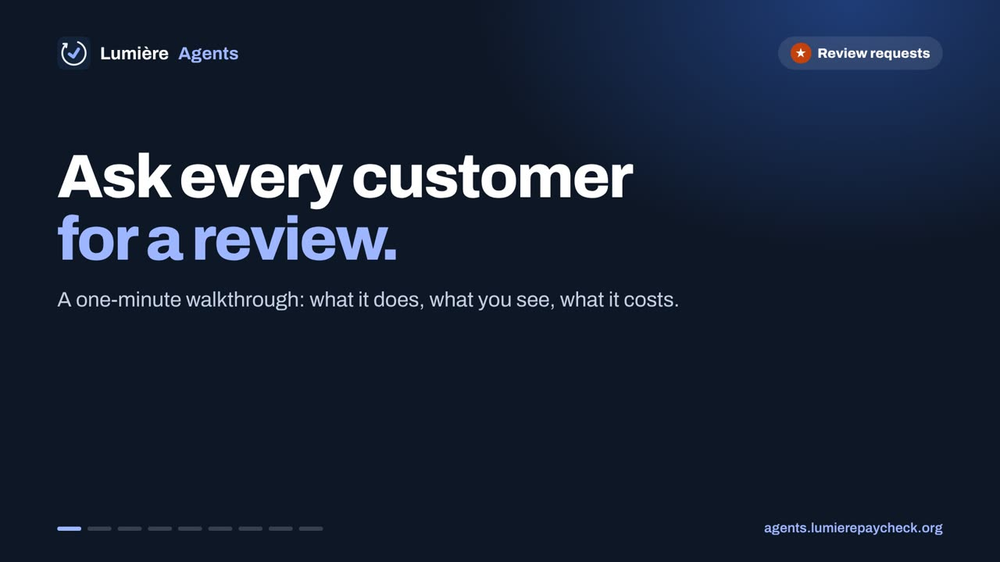</a> | **[Review requests](https://agents.lumierepaycheck.org/review-requests)** | A friendly review request a couple of days after each paid invoice, with your Google (or Yelp, Facebook) review link and one follow-up. No filtering, no incentives. |

<p align="center">
  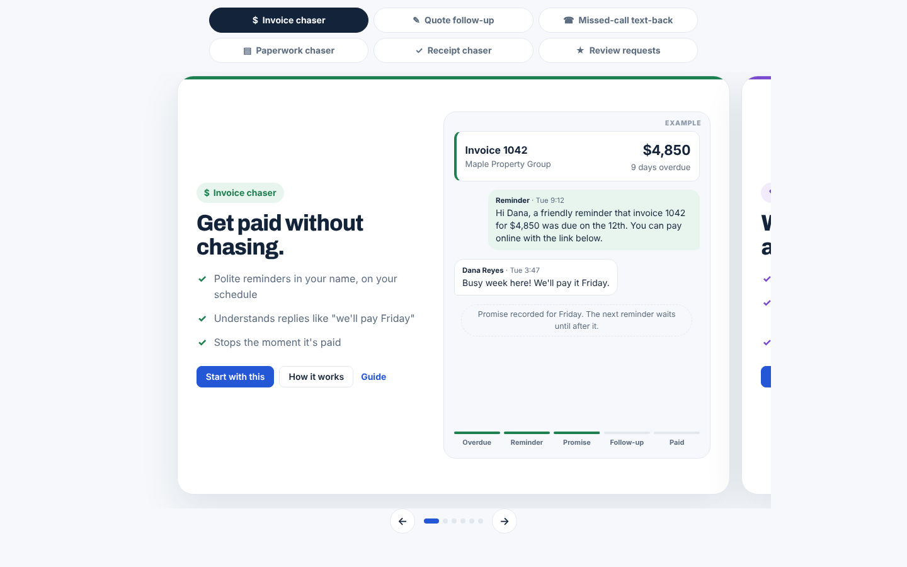
</p>

## How it works

1. **Pick your agents** and sign up. We set them up with you.
2. **Connect what you already use:** QuickBooks, Jobber, Housecall Pro, FreshBooks, Zoho Books, Wave, Square, a Google Sheet or Excel file, or just upload a CSV. We only ever read your books, never write to them.
3. **Send from your own address:** your Gmail, Outlook or any SMTP mailbox (Proton, Zoho and so on), or a verified address on your domain. Texts go out from your own business number.
4. **Approve before anything goes out.** Every agent starts in approve-each-email mode. When you trust it, switch it to send on its own, one agent at a time.
5. **Replies are read and handled.** A promise to pay pauses reminders until that date, a dispute or a question comes to you, and anyone can stop with one click or by replying STOP.

## Pricing

| Plan | Monthly | One-time setup |
|---|---|---|
| One agent | $200/month | $750 |
| Each extra agent | $100/month | $400 |
| **All six agents** | **$500/month** | **$2,000** |
| Enterprise (3+ locations or a larger team) | [Talk to us](https://agents.lumierepaycheck.org/enterprise) | |

No contracts, cancel any time. Prices may change; the [live pricing](https://agents.lumierepaycheck.org/#pricing) is always current.

<p align="center">
  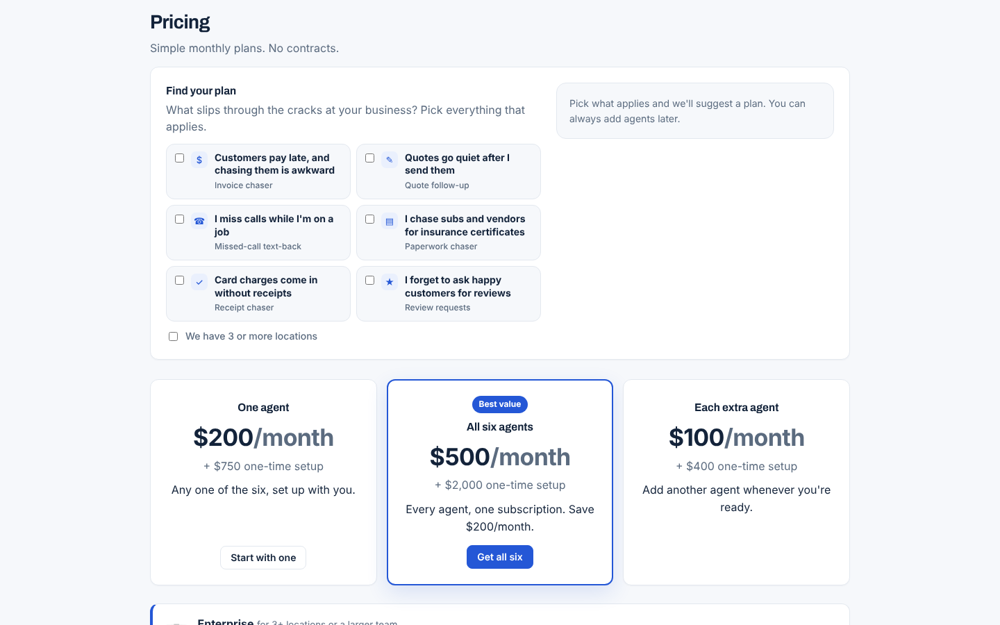
</p>

## The phone app

Install Lumière Agents on your phone's home screen to approve emails, see what's been collected and get notified when something needs you. [How to install it](https://agents.lumierepaycheck.org/install).

<p align="center">
  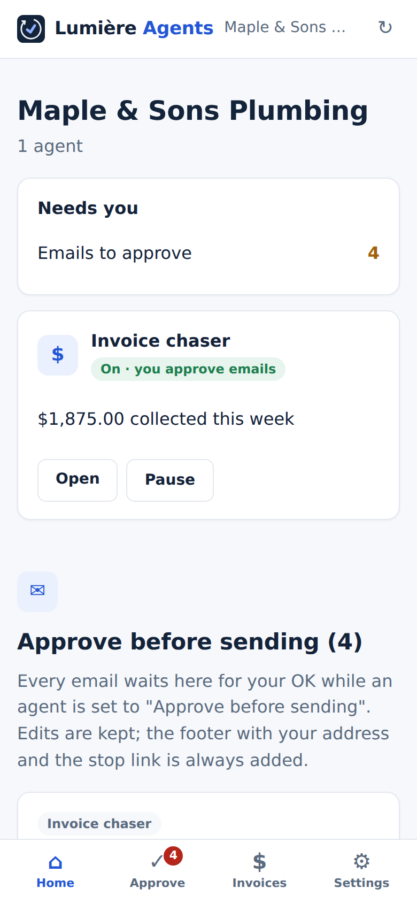
  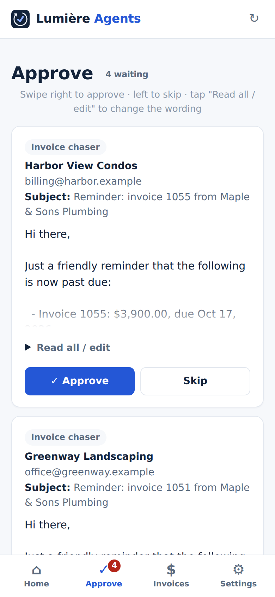
  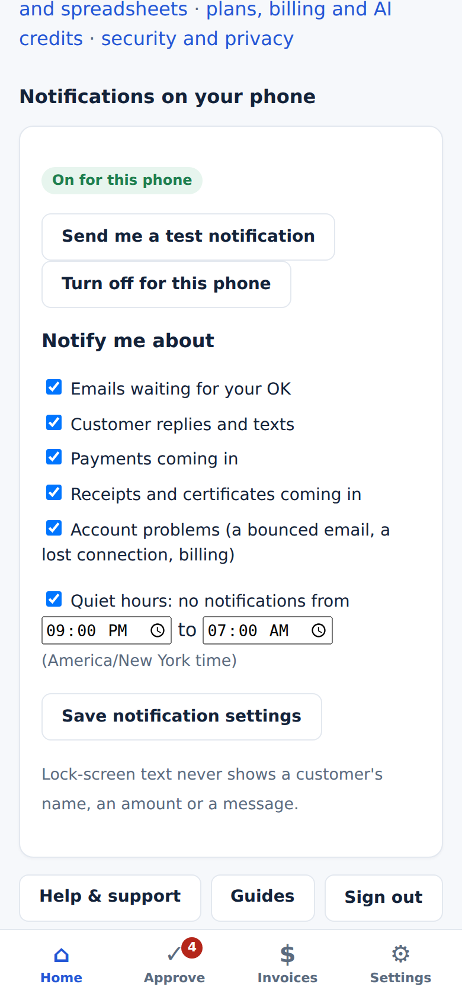
</p>

## Integrations

Accounting and field service: **QuickBooks Online, FreshBooks, Zoho Books, Wave, Jobber, Housecall Pro, Square.** Spreadsheets: **Google Sheets, Excel on OneDrive or SharePoint, any CSV or Excel file.** Email: **Gmail, Outlook, any SMTP mailbox.** Texting: **Twilio** (we can set up and register a number for you). Everything else: **Stripe** pay links, **HubSpot** activity notes, **Zapier**, **Make**, and the [REST API and webhooks](docs/api.md). [All integrations](https://agents.lumierepaycheck.org/integrations).

<p align="center">
  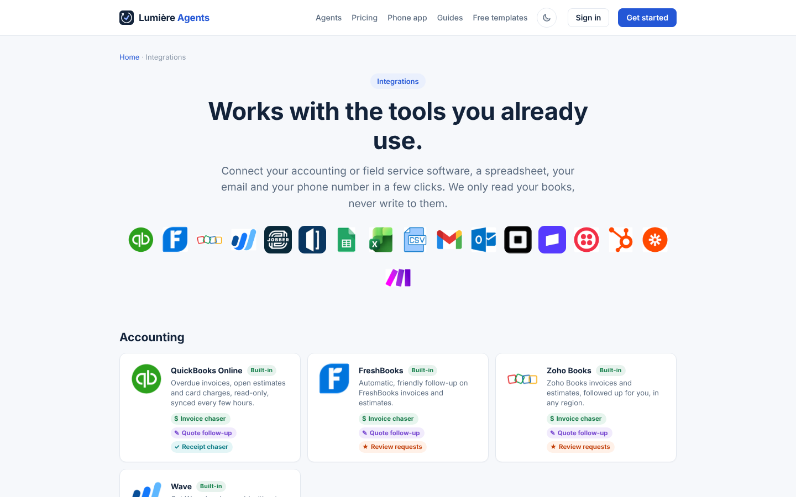
</p>

## For developers

Connect Lumière Agents to your own tools with an API key and webhooks (Settings → API, webhooks and HubSpot, account owner only).

```bash
# Add an invoice for the invoice chaser to follow up
curl -X POST https://agents.lumierepaycheck.org/api/v1/invoices \
  -H "Authorization: Bearer la_your_key" \
  -H "Content-Type: application/json" \
  -d '{"company":"Maple Property Group","email":"ap@mapleproperty.example","invoice_number":"1042","amount":"4850.00","due_date":"2026-11-12"}'
```

- **[API and webhook reference](docs/api.md):** every endpoint, the fields, errors, limits, the events and how to check signatures.
- **[Examples](examples/):** curl, Node.js and Python for adding invoices and marking them paid, plus webhook receivers that check the signature.
- **[Zapier and Make](docs/zapier-and-make.md):** no-code recipes.

## Security and privacy

- Each business's data is walled off with database row-level security that's forced on.
- Connection tokens, API keys and uploaded documents are encrypted with a per-business key.
- No passwords: sign in with a one-time link or 6-digit code. Enterprise can use single sign-on.
- Accounting connections are read-only. Gmail and Outlook connections can only send, never read your mail.
- We don't sell data, don't use it for advertising, and don't use it to train AI models.

Details: [SECURITY.md](SECURITY.md) · [PRIVACY.md](PRIVACY.md) · [Security page](https://agents.lumierepaycheck.org/security) · [Privacy policy](https://agents.lumierepaycheck.org/privacy) · [Terms](https://agents.lumierepaycheck.org/terms)

## Support and feedback

- **Questions or help with your account:** hello@lumierepaycheck.org
- **Found a bug or want a feature?** [Open an issue](https://github.com/Book0fEli/agents-lumiere/issues/new/choose). Issues are public, so never paste customer details, keys or invoices.
- **Security vulnerability?** Report it privately: [security advisory](https://github.com/Book0fEli/agents-lumiere/security/advisories/new) or email hello@lumierepaycheck.org.
- **Live status:** https://agents.lumierepaycheck.org/status

## Refer a business, earn every month

Know businesses that would use this? The [affiliate program](https://lumierepaycheck.org/affiliates) pays a $75 sign-up bonus plus 20% of the monthly price for as long as the customer stays. Great for bookkeepers, accountants, insurance agents and anyone who works with trades.

## Also from Lumière

**[Lumière PayCheck](https://lumierepaycheck.org)** checks x402 endpoints before an AI agent pays them: grades from real paid tests, spend limits and signed receipts. Its public repo: [Book0fEli/lumiere-paycheck](https://github.com/Book0fEli/lumiere-paycheck).

## License

The documentation and example code in this repository are released under the [MIT License](LICENSE). The Lumière Agents service, its name and logo are not covered by that license. Lumière Agents is operated by Lumière LLC, Connecticut, USA.
